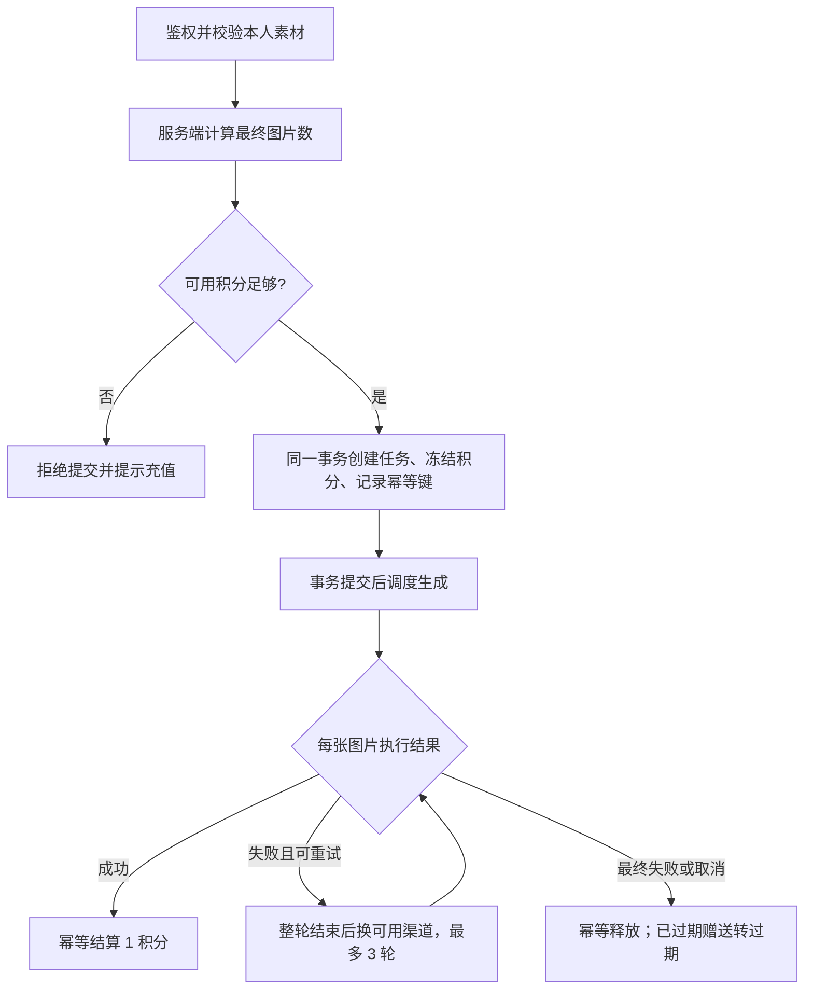
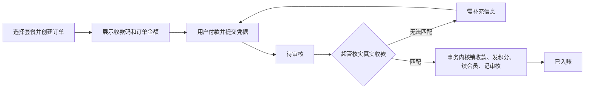

# v4 开发计划：账号、会员、积分与人工充值

## 1. 目标与依据

依据：[开发文档v4.md](./开发文档v4.md)。以第二轮讨论收敛的手机号注册、会员与积分分离、二维码人工收款方案为第一版范围。第三轮用于说明正式支付流程，不代表第一版改为接入自动支付。

本次交付为开发计划，尚未开始实现业务代码。下文未勾选项均为待开发，建议价格和额度不视为已经确认。

目标：将现有单人图片工具升级为小范围试用的多用户平台，完成以下闭环：

**注册验证 → 领取体验积分 → 提交任务冻结积分 → 成功扣费 / 最终失败释放 → 购买套餐 → 管理员核实收款 → 增加积分和会员时长。**

继续保留多图、参考图组合、多比例输出、渠道调度、自动重试最多 3 轮、逐张和 ZIP 下载、模板选择，以及现有简洁界面风格。

## 2. 范围与业务规则

### 2.1 第一版交付

| 模块 | 第一版范围 |
| --- | --- |
| 账号 | 用户名、手机号、密码、短信验证码注册；用户名或手机号加密码登录；短信找回密码；退出登录 |
| 权限 | 超管、普通用户；会员由到期时间动态计算；任务、文件、模板、订单按用户隔离 |
| 积分 | 注册赠送、购买充值、冻结、结算、释放、过期、管理员调整、明细查询 |
| 会员 | 周卡、月卡；到期恢复普通用户权益；续费追加时长；积分余额与会员有效期分开 |
| 充值 | 套餐展示、订单、收款码、用户提交凭证、管理员核实、异常补充材料、唯一入账 |
| 生图 | 按最终图片计费；用户跨任务并发限制；沿用渠道限流和异常停用 |
| 首页 | 用户查看自己的使用数据，超管查看经营、订单、充值、积分和任务数据 |
| 管理 | 用户禁用、套餐上下架、收款码版本、充值审核、积分调整、渠道与公共模板 |

### 2.2 核心规则

1. 1 积分对应 1 张最终图片，多比例输出分别计数；参考素材、上传、下载、OCR 识别、拼接不扣生图积分。
2. 可用积分不足时不允许提交生图任务，会员也不能透支；排队任务冻结的积分不能再次使用。
3. 每个已验证手机号首次注册赠送 3 积分，7 天有效；付费积分不过期，包含会员套餐内积分。
4. 优先使用即将到期的赠送积分，再使用付费积分；按积分来源批次记账。
5. 会员购买积分包只增加余额，不延长会员；购买周卡或月卡增加积分，并按 `max(当前时间, 当前到期时间) + 套餐天数` 延长会员。
6. 周卡和月卡暂采用同一档会员权益；不提供无限量生图、每日重复赠送或自动续费。
7. 同一任务自动重试最多追加 3 轮，成功图片不重复生成，重试不再次冻结或扣费；无可用渠道或取消时停止。
8. 手动重试最终失败图片需重新冻结积分，已经成功的图片不纳入重试；用户明确手动重试的已取消图片也需重新冻结。
9. 已取消或最终失败才释放对应积分；取消后晚到的响应不重复结算，按任务取消判定处理，产生的上游成本单独记录。
10. 冻结的赠送积分跨过有效期仍可完成原任务；失败释放时已过期的部分进入过期流水，不重新变为可用。
11. 手机号、用户名唯一；纯数字用户名不开放，避免与手机号登录歧义。用户名格式与密码长度采用讨论建议，并在前后端统一校验。
12. 非管理员不得访问渠道配置、模型配置、他人数据、全站经营数据或完整上游错误。

### 2.3 保留为配置、尚未确认的事项

| 事项 | 建议值 / 处理方式 | 对实施的影响 |
| --- | --- | --- |
| 积分包 | ¥6 / 30 积分、¥18 / 120 积分 | 作为草稿套餐，不默认上架收款 |
| 周卡 | ¥12 / 100 积分 / 7 天 | 待确定最终售价 |
| 月卡 | ¥36 / 360 积分 / 30 天 | 待确定最终售价 |
| 用户并发 | 普通 1 张、会员 3 张，跨任务合计 | 配置化，不能超过可用渠道能力 |
| 短信 | 服务商、签名、模板及真实凭据待准备 | 可先完成适配器和测试，真实注册上线前必须接通 |
| 收款码 | 用户提供图片，超管后台上传 | 未配置有效收款码时禁用创建人工充值订单 |
| OCR 文字编辑 | 第一版普通用户仅开放识别，额外生图编辑暂不开放 | 属于建议，开放前需确认价格和成本策略 |
| 高级编辑等旧接口 | 超管保留；普通用户只开放已接积分结算的入口 | 禁止从旧接口绕过积分扣费 |
| 超管生图计费 | 建议内部使用不扣用户积分，仍完整记录调用和成本 | 属于实施默认建议，不能默认为普通用户可获得该能力 |

定价目标为单张 ¥0.10–¥0.20；¥0.05 是基础成本假设，不是所有模型、重试和附加编辑的实际成本。超管统计明确区分预估成本、已核实成本和未知成本。

### 2.4 第一版不做

不接真实支付自动回调，不提供自动续费、复杂会员等级、会员专享加购价、优惠券、分销、自动退款和多进程生图调度。正式支付接入列入后续阶段，不影响第一版人工充值闭环。

## 3. 当前项目与改造位置

| 当前实现 | v4 改造 |
| --- | --- |
| FastAPI，`backend/main.py` 集中业务入口 | 新增认证、账户、订单、后台路由，所有旧入口补鉴权 |
| SQLite、`TaskStore` 和直接 SQL | 引入版本化迁移及事务服务，付费试用发布前迁移 PostgreSQL |
| `TaskManager` 内存异步任务 | 接入任务积分冻结、单图结算、恢复补偿及用户并发限制 |
| `ChannelPool` 渠道共享信号量 | 保留渠道限流，增加用户额度和公平排队，渠道只对超管开放 |
| `/api/files/{file_id}` 同时处理源图和输出名 | 统一资源归属查询，输出名、Mask、缩略图、ZIP 均需鉴权 |
| 模板和分类为全站共享 | 私有模板归用户，公共模板归超管；分类同样隔离 |
| 首页聚合全站任务 | 用户统计按 owner 过滤，经营总览另建超管接口 |
| React、Ant Design、ECharts | 新增登录和账户页面，保留苹果风公共样式及柔和状态标签 |
| Docker 与本地启动脚本 | 增加数据库、迁移和初始化说明；验证码测试开关与生产环境区分 |

建议新增后端 `auth`、`accounts`、`credits`、`orders`、`admin` 路由与对应服务；数据库操作通过统一事务边界，避免积分服务和任务服务各自提交导致半成功。对现有模块逐步拆分，不因 v4 重写已经可用的生图流程。

## 4. 阶段安排与交付门槛

按依赖顺序交付，每阶段完成代码、迁移、必要测试和说明后再进入下一阶段。账号上线前先关闭匿名生图，不将未完成积分接入的版本作为收费版本开放。

### P0：迁移基础与存量处理

- [ ] 建立版本化数据库迁移，新增模型、索引、唯一约束和事务接口。
- [ ] 明确 PostgreSQL 部署与测试配置；业务关键事务在 PostgreSQL 上验收。
- [ ] 增加一次性超管初始化命令，由操作者提供密码；不在代码或仓库写默认密码。
- [ ] 备份现有 SQLite 与媒体文件；停接新任务，等待或明确终止当前任务后迁移。
- [ ] 原任务、文件、分析和模板归属初始化超管，历史数据不补扣积分；原输出名访问映射保留但必须鉴权。
- [ ] 迁移脚本可重复执行而不重复导入；迁移后校验记录数量、资源归属和文件引用。

**完成标准：**空库可初始化，现有库可迁移；可恢复备份；原图片与任务仍可由超管访问，其他用户不可见。

### P1：账号、认证与数据隔离

- [ ] 实现短信发送适配器、验证码存储、发送间隔、有效期、尝试次数与用途隔离。
- [ ] 实现注册、用户名/手机号密码登录、退出、找回密码、当前账号接口。
- [ ] 密码安全哈希，随机会话令牌仅保存摘要；HttpOnly Cookie；HTTPS 环境设置 Secure；修改类接口检查 CSRF。
- [ ] 重置密码和禁用用户使旧会话失效；未登录返回 401，无权限返回 403；他人私有资源统一按不存在处理。
- [ ] 为任务、文件、输出、分析、模板、分类、统计增加 ownership 检查；ZIP 与批量接口逐项检查，不能只校验一个 ID。
- [ ] 超管入口使用后端角色依赖；前端路由守卫和隐藏菜单仅负责体验，不能替代鉴权。
- [ ] 普通用户错误提示不返回渠道名称、请求地址、密钥、上游原始响应或内部路径；超管保留排障信息。
- [ ] 完成注册、登录、找回密码页面和登录后导航。

**完成标准：**用户 A 无法通过改 ID、输出文件名、批量参数、下载和重试获取用户 B 数据；手机号验证码不能跨用途复用，禁用后不能继续调用业务接口。

### P2：积分账本与生图结算

- [ ] 实现积分来源批次、可用/冻结余额、只追加流水、到期处理及唯一业务凭证。
- [ ] 注册成功与体验积分发放放在同一事务，手机号重复领取受唯一约束保护。
- [ ] 生成预览展示最终图片数、所需积分和当前可用积分；最终张数由后端计算。
- [ ] 一个事务内创建任务、图片结算记录、冻结分配；提交重复请求使用幂等键，避免双建任务和双冻结。
- [ ] 创建事务提交后再启动执行；提交后进程退出，由恢复逻辑启动已落库任务。
- [ ] 每张图成功与扣费状态原子更新；失败或取消在自动重试全部结束后释放，不能每失败一轮就先退积分。
- [ ] 手动重试创建新的冻结轮次，限制终态图片的可重试集合，自动重试继续使用原冻结。
- [ ] 增加恢复核对：成功图未结算、失败图未释放、已冻结未调度等情况均可幂等补偿。
- [ ] 为旧版单图、批量、高级编辑入口指定超管专用或统一计费策略，关闭普通用户未计费调用路径。
- [ ] 用户工作台改显示积分，不把平台的模型成本当成用户支付金额；增加余额和流水页面。

**完成标准：**并发提交不超扣，1 张成功图只扣一次，自动重试不额外扣费，最终失败/取消正确释放，积分到期和任务跨期正确，任意关键步骤重启后账目可核对。

### P3：套餐、会员与用户任务额度

- [ ] 后台管理套餐价格（整数分）、积分数、会员天数、上下架状态与排序；第一轮建议套餐以草稿方式初始化。
- [ ] 会员根据 UTC 到期时间计算，付费积分不因到期而失效；积分包不续会员，周月卡按剩余有效期叠加。
- [ ] 设置普通/会员跨任务并发上限，并发额度不乘以渠道数；用户与渠道限制同时生效。
- [ ] 调度时避免某用户占用用户额度后长期卡在单个渠道队列，保留其他用户的运行机会。
- [ ] 会员到期只影响后续启动的请求，已开始的请求继续执行，不因到期取消已付积分任务。
- [ ] 新增套餐、会员状态、余额、到期时间展示；积分包和会员卡分别说明到账内容。

**完成标准：**会员续费时长准确，跨订单核实并发不会覆盖到期时间；积分包不改变到期日；一个用户多任务合计遵守额度，多个用户不突破渠道上限。

### P4：人工充值订单与超管审核

- [ ] 用户选套餐创建订单，后端保存金额、积分、天数、套餐名称及收款码版本快照。
- [ ] 超管上传和更换收款码，旧版收款图保留给原订单查看；无有效收款码不接收充值订单。
- [ ] 用户查看订单和付款说明，提交交易单号、付款时间及可选截图，支持补充材料。
- [ ] 凭据文件与普通生图素材区分，禁止被图像编辑、模板引用、拼接或非本人下载。
- [ ] 超管查看待审核队列，核实实际收款，确认金额和交易号；“需补充信息”填写原因。
- [ ] 订单入账事务原子完成：唯一收款核销、积分批次和流水、会员时长、订单状态、审核记录。
- [ ] 同一订单重复核实结果不变；同一收款渠道的交易号唯一，不能核销多个订单。
- [ ] 区分用户提供的交易号和管理员核实的交易号；未核实信息不作为最终收款凭证。
- [ ] 用户只取消未提交凭据的待付款订单；取消后实际已付的订单由管理员走有审计记录的补录核实。
- [ ] 管理员赠送/补偿单独走调整接口，强制原因和幂等凭证，不伪造成已收款订单。
- [ ] 新增我的订单、订单详情、超管审核、套餐设置及收款设置页面。

**完成标准：**付款截图不能直接换积分；两个管理员同时审核不重复入账；改套餐不影响旧订单；换收款码不影响旧单核对；补充材料和取消后补录都能追溯。

### P5：统计、管理与小范围发布

- [ ] 用户首页只统计自己的任务、积分消耗、成功率与会员；超管独立经营总览。
- [ ] 超管图表增加已核实充值金额、套餐销量、发放/消耗/冻结积分、失败重试及成本概览，支持日周月。
- [ ] 收款按核实入账时间、消耗按结算时间统计；任务创建趋势保持原口径，页面说明时间含义。
- [ ] 调用记录区分逻辑图片与实际请求：渠道、模型、请求起止、状态、重试轮次、是否实际发出、成本来源。
- [ ] 实际成本无来源时标记未知，只展示配置单价估算；不能把用户积分消耗或固定 ¥0.05 当实账成本。
- [ ] 用户列表、禁用/启用、积分调整、公共模板、运营错误排查与完整审计。
- [ ] 完成真实短信联调、收款码配置、会话及限流配置、备份恢复与发布说明。
- [ ] 审查公开接口、日志及文件访问；登录前只开放必要认证和公开套餐说明，普通健康探针不暴露模型/渠道信息。

**完成标准：**小范围用户可完成注册、生图、充值审核和到账；普通用户看不到全站数据；超管能追溯每笔入账和积分变化；具备故障恢复记录。

### P6：正式商户支付（后续，不计入第一版）

- [ ] 商户资料和支付产品确定后，先接一种电脑扫码支付方式。
- [ ] 服务端下单、回调验签、核对金额/商户/币种、主动查单、漏单补偿和账单核对。
- [ ] 自动支付与人工核实调用同一个订单入账服务，保留订单来源。
- [ ] 独立退款记录与权限，处理积分已消耗、会员权益已使用和部分退款；不删除历史流水。
- [ ] 再扩展手机网页或微信内支付；换二维码不视为完成自动支付。

**依赖：**商户入驻、应用/域名和 HTTPS 配置、证书密钥及对应支付产品要求。没有真实资料时只完成适配接口和测试，不能宣称已接通收款。

## 5. 数据模型与约束

金额统一用整数“分”，积分用整数，时间统一存 UTC；显示时按用户时区转换。关键约束落到数据库，不能只靠前端校验或进程内锁。

| 数据实体 | 核心字段与约束 |
| --- | --- |
| `users` | ID、规范化用户名和手机号唯一、密码哈希、角色、禁用状态、会员到期时间 |
| `sessions` | 令牌摘要唯一、用户、有效期、撤销时间，不存明文凭证 |
| `sms_challenges` | 手机号、用途、验证码哈希、到期时间、使用时间、尝试数；验证码单次使用 |
| `trial_claims` | 手机号唯一、用户、赠送批次；不因账号禁用或注销而重新允许领取 |
| `credit_accounts` | 用户唯一、可用及冻结总额，余额非负，与批次/流水可核对 |
| `credit_lots` | 用户、来源、原始数量、剩余可用、冻结量、到期时间；付费批次无到期时间 |
| `credit_entries` | 事件类型、各余额变动、用户、批次、业务引用、唯一幂等键、操作者与时间；只追加 |
| `credit_reservations` | 图片任务、手动执行轮次、1 积分冻结状态；同一轮次只能结算或释放一次 |
| `credit_allocations` | 冻结对应的来源批次与数量；释放回原来源，保留赠送有效期 |
| `packages` | 名称、类型、价格分、积分、会员天数、状态；下架保留历史引用 |
| `payment_codes` | 图片资源、版本、启停时间；订单引用不可变版本 |
| `orders` | 用户、套餐快照、价格、积分、天数、收款码版本、状态、入账时间、入账幂等凭证 |
| `order_evidence` | 订单、提交轮次、用户申报交易号/时间、私有截图；保留修订历史 |
| `payment_receipts` | 核实的收款渠道和交易号联合唯一、金额、关联订单、审核人、时间 |
| `membership_entries` | 用户、订单、原到期时间、新到期时间、原因；订单权益发放唯一 |
| `audit_logs` | 操作者、目标、动作、前后摘要和原因；不记录密钥、密码、验证码 |
| `generation_attempts` | 逻辑 job、请求编号、轮次、渠道/模型快照、起止和结果、成本值/来源；不存密钥 |
| 原有业务表 | `tasks`、`files`、模板及分类增加所属用户；文件增加源图/输出/Mask/凭据等用途与关联资源 |

公共模板明确 `public` 范围并由超管管理；用户可使用公共模板、维护自己的模板，不能通过分类接口修改他人的模板。流水和订单只做状态迁移，日常操作不物理删除账目。

## 6. 两条关键事务流程

### 6.1 生图积分结算

账户及批次按固定顺序加锁。任务创建和冻结必须同事务成功；输出写盘采用临时文件/原子替换并保存执行凭证，数据库提交前后崩溃都能区分“有可恢复结果”和“没有成功结果”。上游已接受请求但响应丢失时，不假定未产生费用，记录未知调用状态。

自动重试期间任务保持执行态，冻结不释放。最终结算后用户手动重试是新的冻结轮次，避免原来的已释放记录被重新消费。停用/禁用用户后不再启动新请求，已有请求按结果完成账务处理，不能留下永久冻结。

### 6.2 人工充值入账

先锁订单，再锁积分账户/会员记录，唯一约束保护交易号及权益发放；审核重复请求返回原结果。资金退款与生图失败释放积分是两个流程，不使用同一个“退款”按钮混淆。

## 7. 页面与权限清单

| 页面 | 路径建议 | 可见范围 |
| --- | --- | --- |
| 平台介绍、套餐说明 | `/welcome`、`/pricing` | 未登录可看公开信息 |
| 登录、注册、找回密码 | `/login`、`/register`、`/forgot-password` | 未登录 |
| 我的首页 | `/` | 登录用户自己的统计和账户 |
| 生图工作台 | `/workspace` | 登录用户，提交受积分及额度约束 |
| 我的任务、详情、素材 | `/tasks`、`/tasks/:id`、`/assets` | 本人；超管按权限查看 |
| 我的积分、会员、订单 | `/account/credits`、`/account/membership`、`/orders`、`/orders/:id` | 本人 |
| 私有及公共模板 | `/prompts` | 可读公共及本人私有，修改按所有者权限 |
| 经营总览、用户管理 | `/admin`、`/admin/users` | 超管 |
| 套餐、订单审核、收款码 | `/admin/packages`、`/admin/orders`、`/admin/payment-settings` | 超管 |
| 渠道、公共模板和审计 | `/channels`、`/admin/prompts`、`/admin/audit` | 超管 |

沿用多行输入、Tab 模式切换、模板点击即填入、柔和语义标签。用户侧错误文案说明积分是否扣除、是否自动重试和下一步操作；后台保留详细排障能力。

## 8. 接口清单

### 8.1 新增接口建议

| 范围 | 接口 |
| --- | --- |
| 认证 | `POST /api/auth/sms`、`POST /api/auth/register`、`POST /api/auth/login`、`POST /api/auth/logout`、`POST /api/auth/reset-password`、`GET /api/auth/me` |
| 账户 | `GET /api/account/credits`、`GET /api/account/credit-entries`、`GET /api/account/membership` |
| 套餐与订单 | `GET /api/packages`、`POST /api/orders`、`GET /api/orders`、`GET /api/orders/{id}`、`POST /api/orders/{id}/evidence`、`POST /api/orders/{id}/cancel` |
| 私有凭据 | 订单专用凭据上传/读取接口；归属与用途独立校验，不接生图通用文件引用 |
| 后台用户 | `GET /api/admin/users`、用户启停、积分调整接口 |
| 后台充值 | 套餐 CRUD、收款码上传/启停、订单审核列表、核实入账、要求补充信息、取消后补录接口 |
| 后台统计 | `GET /api/admin/dashboard`、`GET /api/admin/audit`、调用明细 |

创建订单、创建任务、手动重试、管理员调整和核实入账都要有幂等语义。同一幂等键更换业务参数返回冲突，不静默沿用错误结果。金额、积分、会员天数始终由后端读取商品快照。

### 8.2 必须改造的现有接口

- `/api/upload`、`/api/analyze`、`/api/composite`：用户归属、引用文件用途与批量归属校验。
- `/api/generate/multi-image`：积分冻结、每用户并发和提交幂等。
- `/api/generate/batch`、`/api/task/create`、`/api/edit/advanced`：统一积分策略或超管限制，禁止匿名/普通用户绕过收费。
- `/api/tasks`、任务详情、取消、重试、ZIP：按用户过滤及鉴权，恢复和重试不跳过账本。
- `/api/files/{file_id}`：源图 ID、生成图文件名、Mask、缩略图等所有路径均查归属；不能直接公开媒体目录。
- 模板及分类接口：本人/公共范围、管理权限及关联分类归属。
- `/api/dashboard`：只返回当前用户数据，排除渠道与收入信息；全站统计移到超管接口。
- `/api/channels`：所有读写及恢复操作仅超管。
- `/api/health`：公开基础存活状态即可，模型和数据库诊断仅超管可查。

## 9. 测试与验收矩阵

| 场景 | 必须满足 |
| --- | --- |
| 注册和验证码 | 同手机号并发注册仅成功一次、赠送一次；失效/错用途/已使用验证码拒绝 |
| 登录和重置 | 两种账号输入均可登录；错误尝试受限；改密后旧会话失效；CSRF 校验有效 |
| 越权 | 枚举 ID、生成文件名、组合多用户文件、ZIP、OCR、模板分类、统计都不能泄露他人资源 |
| 并发扣费 | 余额 3 积分同时提交两次 2 图请求，只能一笔冻结成功；重复请求不重复建任务 |
| 部分成功 | 10 图成功 7 图、3 图最终失败，最终消耗 7、释放 3 |
| 自动重试 | 同一图初次失败后最多追加 3 轮，始终仅冻结 1；成功即结算一次 |
| 取消和晚响应 | 排队/在途取消及上游晚响应不会形成双扣、双释放或永久冻结 |
| 手动重试 | 失败图重新冻结，已成功图不执行；混合成功/失败的 OCR 依赖链恢复正确 |
| 过期 | 赠送积分先用；跨期冻结成功可结算，失败释放后过期；付费积分不被过期任务清除 |
| 崩溃恢复 | 创建已提交未启动、图片完成未记账、结算失败、释放中断均可重复恢复 |
| 用户额度 | 多任务跨渠道合计不超用户额度；全站不超渠道额度；会员到期不取消在途请求 |
| 入账幂等 | 重复点击、双管理员并发核实只发一次；同收款交易号不能核销两单 |
| 会员续期 | 连续买周/月卡累加；买积分包不续期；到期后付费积分保留 |
| 订单快照 | 套餐改价/下架、收款码更换不改变旧订单；凭据文件只能本人和超管访问 |
| 经营统计 | 真实收款、赠送、消耗、冻结及估算成本分开；日周月边界与用户隔离正确 |

复用现有生图、渠道异常、自动重试和统计回归测试；增加认证、权限、账本、订单、会员测试，关键并发测试使用 PostgreSQL。浏览器验证用户与超管完整路径，包括无积分、无收款码、短信失败、等待审核等状态，不只验证成功路径。

## 10. 发布与回退

1. 本地开发：测试短信使用独立开关和测试收件方式，禁止公网返回验证码；不使用真实支付模拟成功。
2. 迁移演练：备份数据库与媒体，验证导入、约束、归属、账本一致性及超管初始化。
3. 内测发布：单个后端执行进程控制生图任务；迁移只执行一次；生产数据库、会话密钥、HTTPS、CORS 和短信限流配置完整。
4. 开放前检查：所有计费入口已接账本或被权限拦截，真实短信可用，收款码已配置，套餐经确认并上架，管理员审核说明准备好。
5. 发布后核对：监控待审核订单、失败任务、过期冻结及未知成本；抽查积分流水和收款记录。
6. 回退：暂停新订单和新生图，先处理在途任务及积分冻结，保存所有充值与扣费流水，再选择兼容版本回退或恢复演练方案。发生真实充值后不能直接恢复旧数据库抹掉资金记录。

第一版保留单进程调度限制。以后上独立 worker/多副本前，必须将用户和渠道额度、任务认领、恢复协调迁到共享机制，不能直接启动多个现有 `TaskManager`。

## 11. 建议实施顺序

**P0 数据基础 → P1 账号隔离 → P2 积分结算 → P3 会员与额度 → P4 人工充值 → P5 内测发布。** P6 正式支付后续单独启动。

短信资料、收款码和套餐价格不影响先实现数据库、认证接口、账本及测试；缺失时对应生产入口保持不可用，并明确显示配置未完成。具体工期在 P0 数据迁移演练后按阶段评估，不把外部服务商审核时间混入代码开发承诺。
